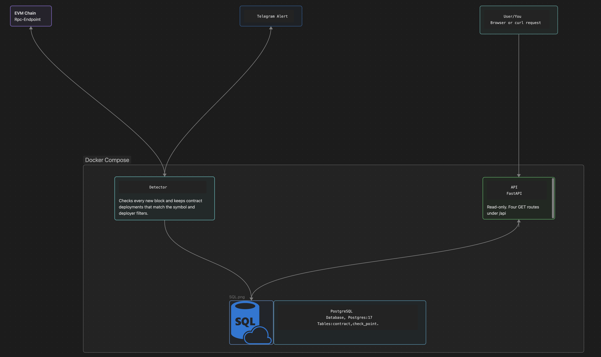

# EVM Contract Detector


EVM Contract Detector watches an EVM-compatible chain block by block and alerts you on Telegram when a new contract is deployed with the token symbol you are waiting for. Every match is saved in PostgreSQL and served by a small read-only API.

It is built to be dependable rather than fast. A crash or a network error never makes it skip a block.

## Disclaimer

This tool reports raw on-chain data: contract addresses and the symbol each contract returns. It does not verify, audit or endorse anything it reports.

Symbols on a blockchain are not unique. Anyone can deploy a contract that returns any symbol they want. What identifies a token is its contract address on one chain, and the same address can exist on two different chains.

This tool performs no supply, ownership or safety checks. Most deployments on public chains are spam, tests or scams. Verify every contract address carefully before you act on it.

## What it does

- Reads every new block with a single `eth_getBlockReceipts` call
- Finds the contract deployments in the block and asks each new contract for its `symbol()`
- Keeps the deployments that match your symbol and deployer filters
- Saves each match in PostgreSQL, then sends a Telegram alert
- Remembers the last finished block and continues from it after a restart
- Serves the saved contracts through a read-only HTTP API
- Starts as three Docker Compose services with one command

## How it works



| Service | Built with | Job |
|---|---|---|
| `monitor` | Python 3.13, asyncio | The detector. It reads the chain, saves matches and sends alerts. |
| `db` | PostgreSQL 17 | Keeps the matches in the table `contract` and the progress in the table `check_point`. |
| `api` | FastAPI | Serves the saved data. It can only read. |

The path of one block:

1. The monitor asks the RPC endpoint for the newest block number.
2. For each block it has not processed yet, it fetches all receipts of that block with one `eth_getBlockReceipts` call.
3. A receipt that carries a contract address is a contract deployment.
4. For each deployment, the monitor calls `symbol()` on the new contract.
5. A deployment that matches the filters is saved in the `contract` table.
6. After the save, the alert goes to Telegram.
7. When the whole block is finished, its number is saved in the `check_point` table.
8. The monitor waits for the polling interval and looks for the next block.

After a restart the monitor continues from the saved checkpoint. With an empty database it starts with the next new block.

## Quick start

You need:

- Docker with Docker Compose
- an RPC endpoint of the chain you want to watch that answers `eth_getBlockReceipts`
- a Telegram bot token and the ID of the chat that gets the alerts

**1. Get the code**

```bash
git clone https://github.com/Roayt/evm_contract_detector.git
cd evm_contract_detector
```

**2. Create your settings file**

```bash
cp .env.example .env
```

Open `.env` and fill in every value. See [Configuration](#configuration).

**3. Start the three services**

```bash
docker compose up -d --build
```

**4. Check that they run**

```bash
docker compose ps
curl http://127.0.0.1:8000/api/health
```

`db` shows as healthy, and `monitor` and `api` show as running. The health check answers `{"status":"healthy"}`.

To follow the monitor at work:

```bash
docker compose logs -f monitor
```

One of the first log lines prints your RPC URL. Do not post these logs in public if your URL holds a key.

**5. Stop**

```bash
docker compose down
```

Your data stays in the Docker volume. `docker compose down -v` deletes it.

## Configuration

All settings live in `.env`. The file `.env.example` lists every one of them with a comment. Git ignores `.env`, so your secrets stay on your machine.

| Group | Settings |
|---|---|
| The chain | `RPC_URL`, `SYMBOL` |
| Telegram | `Telegram_Token`, `Telegram_Chat_Id` |
| Three database passwords that you choose | `POSTGRES_PASSWORD`, `DETECTOR_PASSWORD`, `API_READER_PASSWORD` |
| Four database URLs built from those passwords | `DATABASE_URL`, `DOCKER_DATABASE_URL`, `DATABASE_API_URL`, `DOCKER_DATABASE_API_URL` |

The monitor itself takes these options:

| Option | Required | Default | Meaning |
|---|---|---|---| 
| `--rpc-url` | yes | | RPC endpoint of the chain |
| `--symbol` | yes | | Token symbol to match |
| `--address` | no | | Deployer address filter. It can be given more than once. |
| `--interval` | no | `12` | Seconds to wait between two looks at the chain |
| `--start-block` | no | | Block number to start from |

In the Docker setup, `RPC_URL` and `SYMBOL` come from `.env`. The other options keep their defaults unless you add them to the start command of the `monitor` service.

## API

The API is read-only. It listens on `127.0.0.1:8000`, so only the machine it runs on can reach it.

| Endpoint | Answer |
|---|---|
| `GET /api/health` | `{"status":"healthy"}` when the database answers, status `503` when it does not |
| `GET /api/status` | The last processed block of each chain |
| `GET /api/contracts` | The saved contracts. Filters: `symbol`, `chain`. Paging: `limit` from 1 to 200 with a default of 50, and `offset`. |
| `GET /api/contracts/{contract_address}` | Every saved contract with this address, one entry per chain. Status `404` for an unknown address, status `422` for a malformed one. |

Interactive documentation is at `http://127.0.0.1:8000/docs`.

```bash
curl "http://127.0.0.1:8000/api/contracts?symbol=TEST&limit=1"
```

```json
[
  {
    "id": 1,
    "contract_address": "0x1111111111111111111111111111111111111111",
    "deployer_address": "0x2222222222222222222222222222222222222222",
    "chain": 11155111,
    "symbol": "TEST",
    "blocknumber": 1234567,
    "created_at": "2026-10-01T12:00:00Z"
  }
]
```

The values in this example are made up.

## Design decisions

- **One receipts call per block.** `eth_getBlockReceipts` returns every receipt of a block in one request, so the monitor needs no extra request per transaction.
- **The checkpoint is saved last.** A block number goes into `check_point` only after the whole block is finished. A crash in the middle means the block is processed again after the restart. No block is skipped.
- **Inserts are safe to repeat.** Saving the same contract twice changes nothing, so a retried block creates no duplicates.
- **Save first, alert second.** A match is written to the database before the Telegram alert goes out. If either step fails, the whole block is tried again.
- **A `symbol()` call has three outcomes.** The contract returns a symbol, the contract has no symbol, or the question could not be asked at all. The third outcome has its own marker value, so a network problem is never mistaken for "no symbol".
- **Least-privilege database roles.** The monitor logs in as `detector` and can read and write. The API logs in as `api_reader` and can only read. Neither uses the admin user.
- **Logs cannot fill the disk.** The log file rotates at 5 MB and keeps 3 old files. Docker keeps at most 3 log files of 10 MB for each service.

## Known limits

- Contracts created by other contracts are not seen. The monitor finds deployments made directly by a transaction.
- It reads blocks that are already on the chain. It does not watch the mempool.
- Symbol matching compares the whole symbol and ignores upper and lower case. usdc matches USDC, and USDC.e does not.
- A contract whose `symbol()` call fails three times in a row is skipped, and the monitor logs it as an error.
- There is no reorg handling. If the chain replaces a block after the monitor processed it, a contract from the replaced block stays in the database.
- An endpoint that prunes old history has no receipts for very old blocks, so a start far in the past can fail.
- It has run on testnets only so far.

## Tests

The tests need [uv](https://docs.astral.sh/uv/).

```bash
uv run pytest tests
```

GitHub Actions runs them on every push.

## Project structure

| Path | What it holds |
|---|---|
| `main.py` | Entry point of the monitor |
| `blocks.py` | Block processing and contract detection |
| `rpc.py` | The JSON-RPC calls to the chain |
| `telegram_client.py` | Sends the Telegram alert |
| `db.py` | The database connection and the queries of the monitor |
| `config.py` | Loads the settings from the environment |
| `api.py` | The read-only API |
| `initdb/` | Creates the tables and the two database roles on the first start |
| `docker-compose.yml` | Starts the three services |
| `Dockerfile` | The recipe that builds the application image |
| `.env.example` | Every setting the project needs, without values |
| `tests/` | The tests |
| `docs/` | The architecture picture and its source file |

## License

MIT. See [LICENSE](LICENSE).